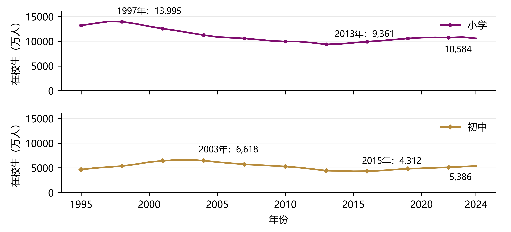

# 中国义务教育生源规模与财政投入趋势分析（1994—2024）

**Chinese Compulsory Education Enrollment and Fiscal Investment Trends, 1994–2024**

见数知势队｜研究数据、分析代码、计算结果、复核资料与统计图示

本仓库是同名研究报告的**数据与分析材料库**，用于理解和追溯1994—2024年中国义务教育生源规模与财政投入的长期变化。研究结合全国年度序列与省级面板，关注生源变化的学段与区域差异、财政性经费规模及收入构成、个人与公用支出结构，以及不同支出项目与生源变化的条件关联。

**请先区分时间与材料性质：**在校生年度序列为1995—2024年；1994年财政性经费为附带假设的条件估算，并非同口径直接公布的观测值；省级回归主窗口为2008—2023年。仓库发布整理数据、计算程序、核查记录和图示，**不包含报告正文的Word或PDF文件**，也不重新分发第三方整本年鉴与论文全文。

## 快速导航

| 想做什么 | 从这里进入 |
| --- | --- |
| **查找正式采用的数据与结果**，区分核准值、估算和历史探索版本 | [数据与分析索引](research/DATA_INDEX.md) |
| **按报告图号查找全部18幅图**，下载PNG、PDF、SVG或绘图数据 | [当前图表索引](visualizations/FIGURE_INDEX.md) |
| 查看年鉴来源、外部原件获取线索、文件完整性和整理记录 | [来源与追溯说明](provenance/README.md) |
| 直接运行文件、目录及关键结果核验 | [复核与复现](#复核与复现) |

版本判断以以上两个正式索引为准。目录名中的日期表示研究工作阶段，**不能仅凭日期较新就认为该目录替代了此前所有成果**。

## 研究内容与主要发现

本研究依次回答三个问题：生源变化如何在小学与初中之间错位、在省份之间分化？财政投入持续扩张时，来源和支出结构发生了什么变化？生源变化与运行相关支出、人员支出的年度变化是否存在不同的条件关联？

现有结果中，主要发现包括：

1. **生源变化具有学段时差与区域反复性。** 小学在校生于1997年达到观察期峰值、2013年降至低点；初中分别为2003年、2015年。省级序列还显示，连续下降并非只发生一次。
2. **财政性经费金额增长与收入占比回落并存。** 2013—2024年，小学与初中财政性收入的名义金额分别增长107.31%和111.27%；2024年财政性收入占同范围总收入的比例分别为91.36%和89.37%。理解全国占比变化，需要同时考察举办者收入权重和类别内部财政性比例。
3. **地方支出扩张的速度和项目构成发生分化。** 在固定的28个省级地区中，2013—2023年个人与公用合计的年均实际增速低于2007—2013年的地区，小学有28个、初中有26个。公用支出内部的商品服务与其他资本性项目，也可能出现增长贡献相互抵消的情况。
4. **细项支出的生源关联存在差异。** 在2008—2023年省级面板中，商品服务相对工资福利的学生响应差为0.766（小学）和0.506（初中），相应Holm校正后p值为0.0008和0.0033。这是控制模型中其他变量后的统计关联，不构成生源变化导致支出调整的因果识别。



*图1：全国小学与初中在校生规模。其余正式图示及各自的数据、生成程序请使用[图表索引](visualizations/FIGURE_INDEX.md)定位。*

## 数据怎么找、怎么读

推荐先打开[数据与分析索引](research/DATA_INDEX.md)，不要从 `research/data/` 根目录随机选择名称相近的文件。以下列出最常用的正式入口：

| 对象 | 时间或样本 | 文件与说明 |
| --- | --- | --- |
| 全国小学、初中在校生 | 1995—2024年 | [national_students_1995_2024.csv](research/data/三十年纵向分析_20261010/national_students_1995_2024.csv)；两学段共60条年度记录 |
| 全国财政性经费及占比 | 1994—2024年 | [national_fiscal_1994_2024_report_final.csv](research/data/早期财政重建_20261011/national_fiscal_1994_2024_report_final.csv)；其中1994年为条件估算，后续为分段整理序列 |
| 公用与个人支出的直接差模型 | 2008—2023年 | [小学模型输入](research/data/定量深化_20261011/primary_model_input.csv) · [初中模型输入](research/data/定量深化_20261011/junior_model_input.csv) |
| 商品服务与工资福利的直接差检验 | 每学段472条完整省年、31个省级聚类 | [component_primary_tests.csv](research/data/支出细项与补助拓展_20261011/component_primary_tests.csv)；模型输入、排除记录和计算回执见所在目录 |
| 报告采用的18幅统计图 | 与各图对应 | [图表索引](visualizations/FIGURE_INDEX.md) · [机器可读索引](visualizations/figure_index.csv) |

### 必须注意的统计口径

- **金额与占比不同。** 财政性收入金额衡量资金规模；财政性收入占比的分母为同统计范围的总收入。全来源支出则用于讨论学校对不同来源经费的使用，不能将收入与支出系列直接视作同一指标。
- **1994年是条件估算。** 早期经费经历资料重建与来源分类衔接，1994年情景范围衡量分配假设变化，不是回归置信区间。1998年、2002年及2007年前后的来源组成和分类衔接，须连同[早期财政重建](research/data/早期财政重建_20261011/)与[经费断点核查](research/data/经费断点再核查_20261012/)阅读。
- **学校隶属口径和地区样本随问题而定。** 长期历史支出采用地方隶属口径，回归分析采用全隶属口径；跨期增速的固定地区比较使用28个省级地区，不应与31省面板混用。
- **实际增速经过价格调整。** 使用各地区CPI估算实际变化；CPI只提供一般物价平减，不能等同于学校特定投入成本指数。
- **探索材料不等于正式采用结果。** 原值候选、被排除观察、敏感性分析及早期图组均予保留，以便追溯研究过程。正式数据及图号以索引为准。

常见变量：`stage=primary/junior`分别代表小学/初中；`year`为实际数据年；`P`为个人支出，`C`为公用支出，`W`为工资福利，`G`为商品和服务，`X`为其他资本性项目，`R`为地方自身财政收入，`B`为中央补助背景指标。文件名中的 `*_yi` 表示亿元，`*_thousand_yuan`表示千元，`*_pct`表示百分数。具体指标定义、缺失及排除规则请查看对应数据目录中的说明和程序。

## 仓库结构

```text
.
├── research/
│   ├── DATA_INDEX.md       正式数据与结果的阅读入口
│   ├── data/               原值账本、核准数据、模型输入、计算结果和阶段核查
│   ├── scripts/            抽取、清洗、统计分析、稳健性检查和制图
│   ├── raw/                可随仓库分发的公开原始附件
│   ├── converted/          部分原表的机器可读转换文件
│   ├── notebooks/          核查笔记本
│   ├── notes/              研究设计、方法说明及资料获取记录
│   └── figures/            专题图组和历史绘图材料
├── visualizations/
│   ├── FIGURE_INDEX.md     当前18幅图的统一图号、文件、数据和程序
│   └── figure_index.csv    同一索引的机器可读版本
├── provenance/             来源索引、SHA-256清单、发布与整理记录
├── tools/                  文件完整性、目录及关键结果复核工具
├── requirements.txt
└── CITATION.cff
```

`research/figures/`保留专题图组和历史图号，例如 `fig04` 或 `图F3`；其名称不一定等于报告最终编号。查找可直接用于报告或引用的图示，统一使用 [FIGURE_INDEX.md](visualizations/FIGURE_INDEX.md)。PNG适合快速预览，PDF和SVG提供矢量版本；相应CSV与生成程序可从索引逐图进入。

## 复核与复现

本仓库提供不同层次的复核入口：**文件完整性校验、目录和图表链接检查、关键统计结果复算，以及依据保存的模型输入重新运行分析**。这些层次不能混为一谈；当前发布并未验证“从全部第三方原始年鉴到全部最终结果”的一键全流程重跑。

### 1. 准备环境

建议使用Python 3.12及以上版本，在独立环境中克隆仓库并安装依赖：

```bash
git clone https://github.com/hengdaoye50/china-compulsory-education-enrollment-fiscal-investment-1994-2024.git
cd china-compulsory-education-enrollment-fiscal-investment-1994-2024
python -m pip install -r requirements.txt
```

### 2. 不重新估计模型，先检查现有发布成果

在**仓库根目录**运行：

```bash
python tools/verify_release.py
python tools/verify_repository.py
python tools/check_key_findings.py
```

| 命令 | 实际检查内容 |
| --- | --- |
| `verify_release.py` | 对照发布清单核验文件SHA-256，并检查gzip文件解压后的逻辑内容散列 |
| `verify_repository.py` | 检查目录、索引链接、Python语法、18幅图与绘图数据/生成程序的对应关系，以及临时文件清理情况 |
| `check_key_findings.py` | 独立复算全国生源峰谷、财政性收入增长、主要直接差OLS系数和公用支出分项增长贡献恒等式 |

**特别说明：**第三项会读取已保存的野生聚类自助检验p值，**不会重新执行9,999次自助抽样**。因此，“关键系数复算通过”不等于“所有统计推断均已重新运行”。整理阶段的既有执行记录见[仓库核验记录](provenance/repository_audit_20261012.json)。

### 3. 按需恢复压缩原值

两份体积较大的原值CSV以gzip无损形式发布。涉及原始候选值和原格账本的程序在使用前，可运行：

```bash
python tools/materialize_data.py
```

该工具核对解压内容散列后恢复 `education_finance_original_candidates.csv` 和 `raw_value_ledger.csv`；恢复后的副本由Git忽略。初始文件与逻辑文件的映射、散列均登记在[发布清单](provenance/README.md)。

### 4. 按研究模块重新分析或制图

| 目的 | 主要程序 |
| --- | --- |
| 公用与个人的直接响应差分析 | [deepen_quantitative_analysis.py](research/scripts/deepen_quantitative_analysis.py) |
| 商品服务、工资福利及中央补助拓展 | [analyze_spending_components_subsidies.py](research/scripts/analyze_spending_components_subsidies.py) |
| 财政分类年份与分时期敏感性分析 | [check_component_regime_sensitivity.py](research/scripts/check_component_regime_sensitivity.py) |
| 教师、班级等资源变量拓展 | [extend_resource_explanations.py](research/scripts/extend_resource_explanations.py) |
| 部分正式趋势、区域及统计图重绘 | [build_revised_figures.py](research/scripts/build_revised_figures.py) |
| 单独重绘举办者构成分解图 | [replot_fig3_20261012.py](tools/replot_fig3_20261012.py) |

这些程序面向已经整理的阶段输入，并非彼此独立的“一键完整流水线”；须依照对应阶段目录的输入、回执和依赖关系运行。部分分析脚本会**覆盖本阶段生成的结果文件**，建议先在仓库副本中操作。核心分析程序的野生聚类自助检验显式设置 `B=9999`，重跑需要额外计算时间；跨平台重绘时，部分旧脚本使用Windows中文字体路径，需按本机环境调整，图3程序支持 `MPL_CJK_FONT`。

## 数据来源、研究边界与可追溯性

资料主要来自教育统计年鉴、教育经费统计年鉴、财政及综合统计年鉴，以及教育部、国家统计局和地方官方材料。原值账本和来源索引保留表格位置、单位、核查状态及原件获取信息；[provenance/](provenance/README.md)提供发布文件清单、SHA-256和[目录整理记录](provenance/repository_cleanup_20261012.csv)。原始证据中的旧路径按形成时状态保留，可借助整理记录映射现存文件。

出于第三方材料分发限制，整本年鉴、论文全文、扫描件及字体未纳入公开包；从年鉴重新抽取时需要依据来源索引自行获取相应原件。报告中的省级模型用于比较**条件关联**，固定效应与聚类推断并不能自动消除时变遗漏、反向因果或跨省相关，因而不应将系数解释为已经识别的因果效应。

## 引用与使用

引用原始统计数据时，请同时标明相应年鉴或官方发布机构；引用本仓库整理数据、代码或图示时，可使用仓库提供的 [CITATION.cff](CITATION.cff)。当前未为自编代码及衍生材料指定独立开放许可证；请勿仅凭仓库可公开访问就推定其具有某项开放许可。

**发布说明：**本仓库保留正式采用版本与必要的历史核查记录，但不收录报告写作、Word排版与PDF成稿。关于已归档的旧图稿、重复文件和历史路径，请查看[整理记录](provenance/repository_cleanup_20261012.csv)或Git历史。
